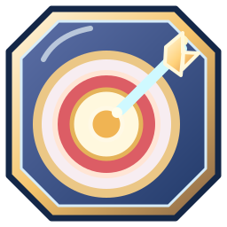
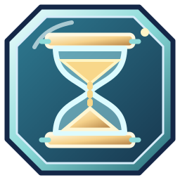

# МатКвест · UX-101 — 40 стикеров, staging PWA v100
**Контрольная точка:** 8 ноября 2026 · ветка `ux-final/ux00-inventory-20261108` · production `main` по-прежнему v81.

## Девять новых оригинальных SVG

Все изображения — самостоятельные квадратные 256×256 SVG в едином восьмиугольном эмалевом оформлении, не emoji и не перекрашенные копии. Для всех девяти сохранена отдельная композиция, собственная цветовая палитра и читаемый силуэт.

| | | |
|---|---|---|
|  **Карандаш** · обычный · 28 монет · ур. 1 |  **Сердце** · обычный · 33 · ур. 2 |  **Точная цель** · обычный · 36 · ур. 2 |
|  **Песочные часы** · необычный · 46 · ур. 3 |  **Лупа исследователя** · необычный · 47 · ур. 3 |  **Геймпад** · редкий · 61 · ур. 5 |
|  **Робот-помощник** · редкий · 63 · ур. 5 |  **Портал знаний** · эпический · 82 · ур. 7 |  **Феникс победы** · легендарный · 125 · ур. 10 |

## Проверенный ассортимент

- **40/40 оригинальных стикеров SVG**, старые 31 ID, цены, редкости и наградные условия остались неизменными.
- Редкости: **12 обычных, 9 необычных, 8 редких, 6 эпических, 5 легендарных**.
- Все новые 9 доступны за монеты с указанного уровня. Три старых наградных стикера остаются `rewardOnly` и недоступны для покупки.
- 50 значков и 55 аватаров не менялись.
- Группа по три избранных сохранена; новые предметы появляются в магазине, коллекции, профиле и рейтинге.
- **PWA v100**: все девять новых SVG добавлены в офлайн-кеш; HTML SHA-256 синхронизирован с `sw.js`.

## Технический Gate

**GitHub Actions: [UX-101 run #42497834201](https://github.com/jokino9212/matkvest/actions/runs/42497834201) — SUCCESS, 3/3 jobs.**

- Шесть разрешений **320/360/390/430/768/1280 px**: магазин 40/40 картинок, без сломанных файлов и горизонтального переполнения; коллекция содержит все 9 новых предметов.
- Проверена реальная покупка: `st_pencil` списывает **28 монет**, зачисляет покупку и увеличивает `shopStats.spent` на 28.
- Профиль и рейтинг: три квадратных избранных без растяжения и обрезки, переключение сохранено.
- Artwork QA: SVG проверены на уникальность источников, валидные локальные пути, запрет script/foreignObject/onload/external URL; на 32px худшая измеренная контрастная вариативность **46.5**, ошибок **0**. Сформирован contact sheet **40 стикеров при 32 и 128 px**.
- Регрессии: мобильный рейтинг, 55 аватаров, 50 значков, питомцы/viewer и стоимость коллекции.
- Реальная PWA-миграция **v81 → v100** в Chromium: профили, монеты, XP, прогресс, черновик тренировки, офлайн-перезагрузка и магазин без потери данных.
- GitHub Actions сохранил скриншоты и contact sheet в артефакте [`ux101-40-original-stickers-art-mobile`](https://github.com/jokino9212/matkvest/actions/runs/42497834201/artifacts/13623663292).

## Что не означает статус PASS

Это техническая и автоматизированная художественная проверка с контактным листом, **не замена пользовательского визуального одобрения**. На физическом Android PWA не проверена. В production изменений приложения не было. **Остаётся 20/30 реальных питомцев**, цель: создать ещё минимум 10 качественных питомцев и выполнить полную художественную приёмку перед релизом.
