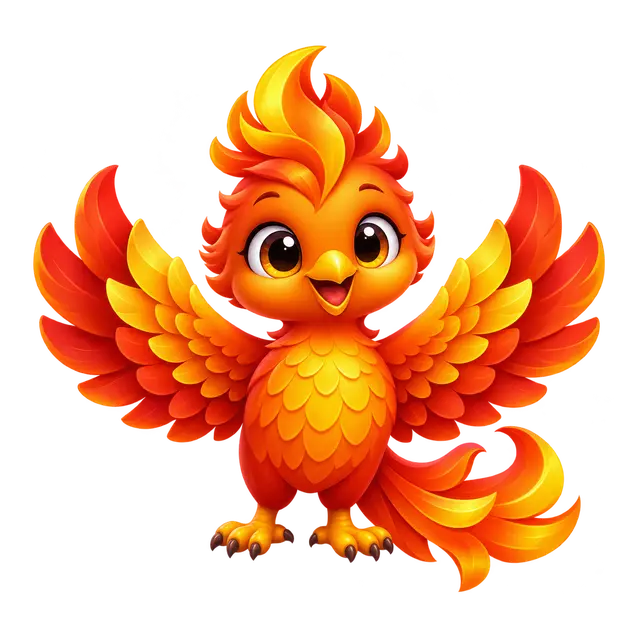
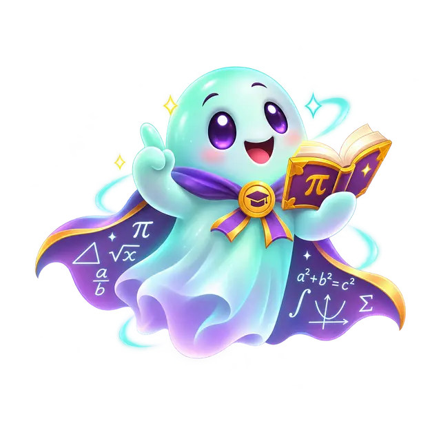

# МатКвест — UX-103R: исправление качества трёх питомцев, staging PWA v102

**8 ноября 2026 · исходная рабочая ветка:** `ux-final/ux00-inventory-20261108`

## Почему пришлось переделать UX-103

После технически успешной v101 художественная приёмка владельцем выявила существенное снижение качества. Три предыдущие ручные плоские SVG были **неприемлемы как финальные персонажи**, несмотря на технические зелёные тесты и отсутствие битых картинок. Сравнение проводилось с качественными объёмными персонажами, которые понравились владельцу. **Итог: прежнее решение отозвано, UX-103R заменяет его именно в UI-каталоге.**

## Итоговые оригинальные персонажи (настоящие изображения из репозитория)

| Феникс · эпический | Сфера знаний · легендарный | Призрак формул · легендарный |
|:---:|:---:|:---:|
|  |  |  |
| `pet_phoenix` · **820** монет | `pet_orb` · **1050** монет | `pet_ghost` · **1500** монет |

Каждый — самостоятельное детализированное **640×640 WebP RGBA** с честной прозрачностью, мягким объёмным светом, читаемым выразительным лицом, тщательной прорисовкой деталей и полноценным персонажным силуэтом. **Векторные SVG из v101 оставлены лишь как исторические исходники**, не используются в текущих иконках каталога и не загружаются в офлайн-кеш v102.

| Файл | WebP байты | SHA-256 |
|---|---:|---|
| `assets/source/pets/pet_phoenix.webp` | 61 008 | `a49ae7c1e5995adb07ea56f368a7f8d7705fe3c3eb5148835970dc28e3ffa16e` |
| `assets/source/pets/pet_orb.webp` | 58 886 | `0c32911019a2ba4b66addf1ef02c3be1ef9715db94fdb4aaff5bc161152b200e` |
| `assets/source/pets/pet_ghost.webp` | 53 176 | `4f31e2dc465601132467aba0127b1eb865be1a8e817d53797b5d62afdf07713a` |

## Гарантии совместимости

- **ID, редкости, уровни, цены, инвентари и сохранённые покупки не изменялись.** Меняется только значение `icon` у трёх существующих `SHOP_CATALOG.pets`.
- Один и тот же premium WebP отображается в магазине, коллекции, таблице лидеров и fullscreen; от ненужных фоновых плиток внутри объекта отказались.
- `sw.js`: `matkvest-iphone-v102`; три новых WebP в `APP_FILES`, старые три SVG удалены из кеш-листа; HTML SHA-256 в SW синхронен.
- Старые SVG остаются в git для аудита, но **не должны возвращаться как активные изображения**.
- Production `main` **по-прежнему PWA v81**, реального деплоя в production НЕ было.

## Проверки, которые действительно выполнены

**Полный Gate**: [UX-103R run 42510611153](https://github.com/jokino9212/matkvest/actions/runs/42510611153) — **SUCCESS 3/3 jobs**.

- 48/128/384 px на светлом и тёмном фоне: три разных WebP; 0 непрозрачных углов; alpha-контент на холсте **34–44%**; персонажи занимают **84–90%** по ширине в крупном разрешении. Действительные угловые alpha = 0.
- `320,390,768,1280` px: изображения декодируются без ошибок; магазин, коллекция, рейтинг, fullscreen и покупка работают.
- **Скриншоты реально загружены и просмотрены** после публикации: `zoom_pet_phoenix_320.png`, `zoom_pet_orb_320.png`, `zoom_pet_ghost_320.png` — финальные WebP в настоящем viewport 320px, не декоративные примеры.
- Реальная карточка магазина: каждое изображение **61.1875×61.1875px** в 70px слоте, `object-fit:contain`, горизонтального выхода нет. Компактный значок активного питомца в header ~13px — отдельный UI-элемент и не считается размером shop art.
- Регрессии: все **40** стикеров, **50** значков, **55** аватаров, другие питомцы, zoom/Esc, мобильная таблица лидеров и стоимость склада.
- Пробная **PWA-миграция v81→v102**, два профиля, XP/монеты, сохранённая попытка и офлайн-режим — PASS.
- Полные реальные browser screenshots + art report: [`ux103r-premium-pets-gallery-mobile-qa` artifact](https://github.com/jokino9212/matkvest/actions/runs/42510611153/artifacts/13628939108).

**Художественная оговорка:** автоматические проверки прозрачности, размеров и декодирования не заменяют вкусовое одобрение владельца. Конкретные рисунки представлены в таблице выше и в оригинальных файлах.

## Следующая очередь работ

UX-104: заменить 10 повторно используемых у аватаров изображений питомцев на **самостоятельные объёмные WebP / 2.5D иллюстрации такого же класса качества**, сохраняя аватары, IDs, цены и награды. **Не возвращаться к плоским ручным схемам**, а сначала показывать реальный арт на 64px и крупно.

UX-105: затем создать ещё 10 новых настоящих питомцев до **30/30**. На текущей стадии по-прежнему 20 настоящих, хотя три теперь качественно переработаны. Реальное Android touch и пользовательская финальная приёмка до production обязательны.
