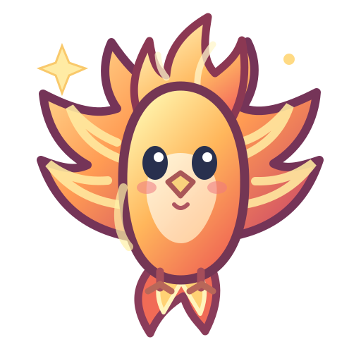

# МАТКВЕСТ · UX-103 — три оригинальных питомца и приёмка staging v101

**Дата:** 8 ноября 2026 · **рабочая ветка:** `ux-final/ux00-inventory-20261108` · **production `main`: v81, не изменён.**

## Визуальная приёмка

| Феникс | Сфера знаний | Призрак формул |
|:---:|:---:|:---:|
|  |  |  |
| `pet_phoenix`, эпический, 820 монет | `pet_orb`, легендарный, 1050 монет | `pet_ghost`, легендарный, 1500 монет |

Созданы три **разные** 512×512 SVG-иллюстрации: феникс с огненными крыльями и хвостом, кристальная сфера-спутник с кольцами и раскрытой книгой, призрак в фиолетовой накидке с математическими символами. Точное происхождение: нарисованы специально для «МатКвест», не скопированы с внешних персонажей. Прозрачность настоящая, нет закрашенных углов/непрозрачных квадратных подложек; одна и та же source-картинка используется в карточке и полноэкранном просмотре.

**Фактически визуально просмотрены** снятые браузером изображения:
- `three_pets_48_128_384_light_dark.png` — исходные арты на светлом и тёмном фоне;
- `zoom_pet_phoenix_320.png`, `zoom_pet_orb_320.png`, `zoom_pet_ghost_320.png` — реальные 320px модальные окна, рисунки крупные, кнопка закрытия доступна, текст не съехал;
- `shop_320.png` и `shop_768.png` — реальные мобильный и планшетный контексты.

Все эти файлы доступны в GitHub Actions artifact: [`ux103-pets-artwork-and-responsive-checks`](https://github.com/jokino9212/matkvest/actions/runs/42506894704/artifacts/13627518912).

## Интеграция в приложение

- Не переименовывались `pet_phoenix`, `pet_orb`, `pet_ghost`. **Не изменены цены, редкости, уровни, сохранённое владение и существующие наградные условия.**
- `SHOP_CATALOG.pets[*].icon` у этих трёх после всех предыдущих декораторов теперь указывает на `assets/source/pets/*.svg`.
- Питомцы присутствуют в магазине, коллекции и таблице лидеров. Зум/закрытие Esc проверены. Пустая запись `pet_none` по-прежнему без artwork.
- Браузерный стресс конкретных карточек на **320/390/768/1280 px**: все три рисунка имеют реальную видимую CSS-область **61.1875×61.1875 px** в 70px слоте магазина, `object-fit:contain`, без искажения. Маленькая иконка выбранного питомца в шапке (~13px) — отдельный индикатор; это не размер картинки карточки.
- PWA-кеш `matkvest-iphone-v101` включает три SVG; `APP_BUILD_HASH` точно соответствует HTML.

## Проверки

**[UX-103 полный Gate #42506894704](https://github.com/jokino9212/matkvest/actions/runs/42506894704): SUCCESS, 3/3 jobs.**

Художественный тест: 3 разных SHA-256, проверка 48/128/384px, alpha coverage **35.7–45.3%**, ширина контентного силуэта **74–80%**, все угловые alpha = 0, ни одной ошибки/битого SVG.

Функциональный тест: магазин **21 позиция** (включая служебное `pet_none`), **20 настоящих питомцев**, все три новых SVG в магазине/коллекции/рейтинге/fullscreen. Старые 40 стикеров, 50 значков, 55 аватаров, другие питомцы, стоимость коллекции и мобильный лидерборд прошли регрессии.

Обновление **production PWA v81 → staging v101** на том же origin без потери двух профилей, монет, XP, прогресса и незавершённой попытки; проверен offline reload.

**[UX-103 post-deploy card-size Gate #42507278943](https://github.com/jokino9212/matkvest/actions/runs/42507278943): SUCCESS.**

## Открытые вопросы

- В тесте покупки `pet_ghost` счётчик `shopStats.spent` увеличился на **1500**, но чистое уменьшение `state.coins` составило **1417** (12000 → 10583). Дополнительные **83 монеты** появились как параллельное начисление; его источник **не расследован**. Не считать доказательством скидки или ошибкой стоимости самого питомца без отдельного аудита наград.
- Android на физическом телефоне и эстетическое согласование владельцем проекта ещё не подтверждены.
- Не завершён весь каталог питомцев: **20/30** настоящих. На UX-104 остаются **10 повторно использованных у аватаров изображений**; на UX-105 — ещё ≥10 оригинальных питомцев. Не менять хорошие аватары вместо своих рисунков питомцев.

**Вердикт:** UX-103 технически DONE в staging v101, UX/UI FINAL в целом **NO GO для автоматического production merge**.
