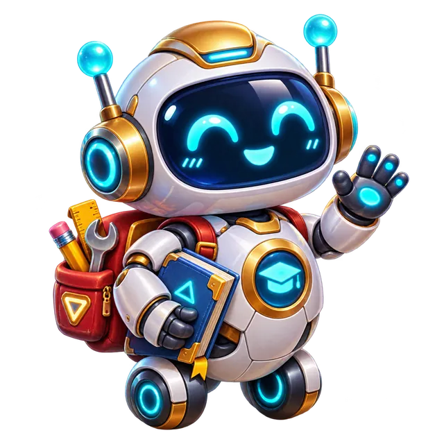
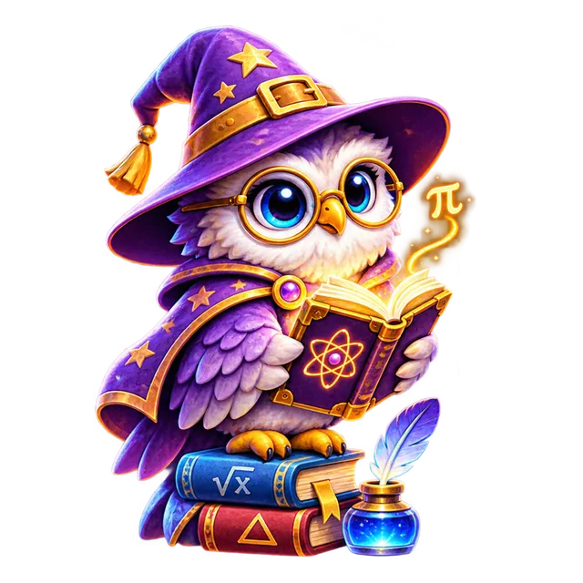
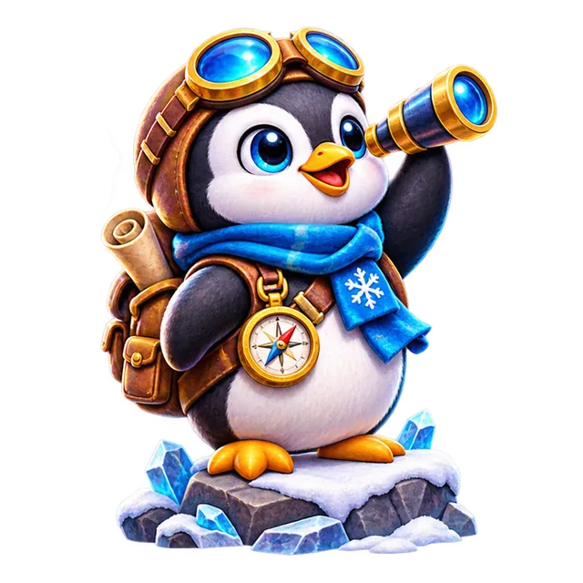
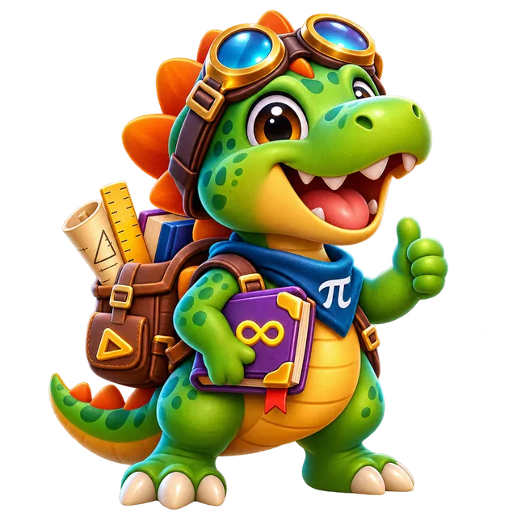
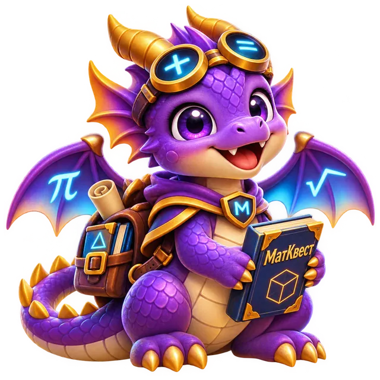
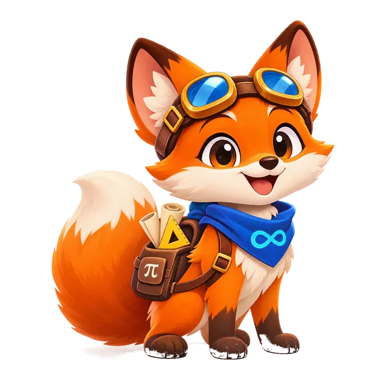
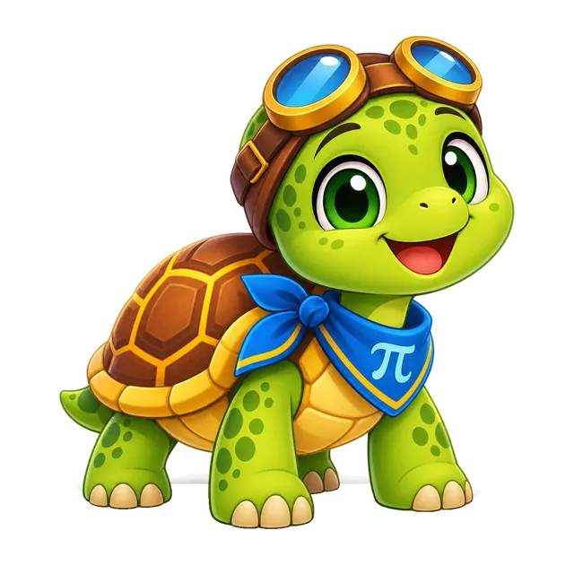
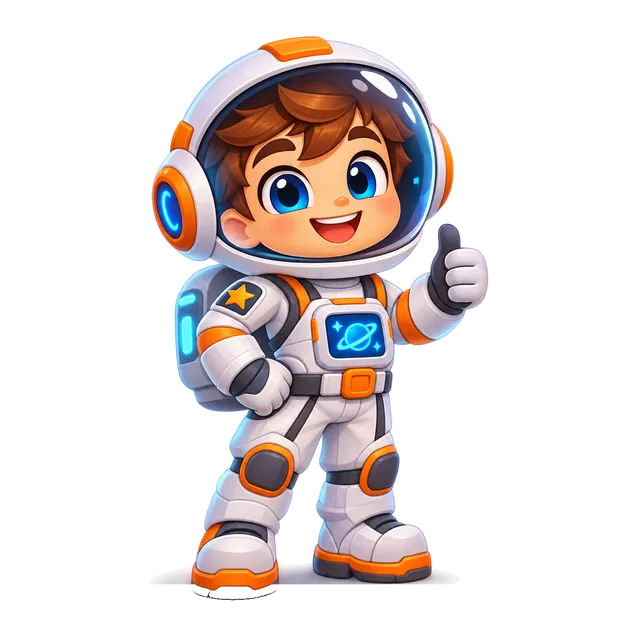

# МатКвест · UX-104 · итоговый художественный просмотр всех 10 настоящих кандидатов

**Дата:** 9 ноября 2026. **Состояние:** все 10 отдельных оригинальных WebP RGBA 640×640 сохранены в GitHub и прошли совместную техническую проверку в настоящем браузере. **Художественная приёмка пользователем ещё не выполнена; не считать рисунки утверждёнными или выпущенными.**

**Истина:** рабочая ветка `ux-final/ux00-inventory-20261108` · staging PWA **v102**, production **v81**.

## Одна галерея для сравнения всех 10 рисунков

Все изображения ниже подлинные `assets/candidates/pets/*.webp` из этого репозитория, а не референсы, изображения других игр или генерация инфографики.

| 1 | 2 | 3 | 4 | 5 |
|:---:|:---:|:---:|:---:|:---:|
|  |  |  |  |  |
| **Мини-бот** | **Сова** | **Пингвин** | **Динозавр** | **Кот** |
|  |  |  |  |  |
| **Дракончик** | **Лисёнок** | **Черепашка** | **Тигрёнок** | **Космо-напарник** |

**Контакт-лист проверок 48/128/384 px:** хранится в [GitHub Actions artifact `ux104-all-10-premium-mascots-human-art-review`](https://github.com/jokino9212/matkvest/actions/runs/42574010345/artifacts/13654501258). Также сохранён в пользовательской Библиотеке ChatGPT `/МАТКВЕСТ/UX104/UX104_all10_visual_review.png`, а полный ZIP Chromium screenshot и JSON — в той же папке Library.

## Подлинные ID и неизменяемые метаданные

| Pet ID | Название из настоящего каталога | Цена | Rarity | Уровень | SHA-256 кандидатного файла |
|---|---|---:|---|---:|---|
| `pet_bot` | Мини-бот | 240 | uncommon | 3 | `f352dd29dbbcea07e15d5a8b69ae03e7f4286a977c490e2672badbc625efc113` |
| `pet_owl` | Сова | 270 | uncommon | 4 | `4bfaaa6e118047f59081c679bf7161217f8ddb8f0e9d2996468ae5aa84e6ad1d` |
| `pet_penguin` | Пингвин | 300 | rare | 5 | `96c726213840a2b03db6f3f000b80d236f3a09e7fc16c16ba313f7d236127ec2` |
| `pet_dino` | Динозавр | 360 | rare | 6 | `63bb54a3516474bb25507a15dff64065a0281f9bb3ae68da079fdb0ccb2cc52c` |
| `pet_cat` | Кот | 390 | rare | 7 | `9832ef0f4c62ed5cbd9d16a7d54cfb8bf93fada48c124ce369d2340ff3b3b9ad` |
| `pet_dragon` | Дракончик | 500 | epic | 9 | `86e0af857742de85ab2b3c51674af9aa93387267aa453a300274d28d50bdd15f` |
| `pet_fox` | Лисёнок | 260 | uncommon | 3 | `84159441a3a024ac11a040f3b1e2e33c434e921927822412c6df2cf74c96c294` |
| `pet_turtle` | Черепашка | 280 | uncommon | 4 | `67781335a573bccab5708700241270c6d53943816f8da3a14f3b1d576080e49c` |
| `pet_tiger` | Тигрёнок | 340 | rare | 6 | `56355847109bc7311d8928ce8c04ed82fb04556e5dc04b97b087b98e34b2b989` |
| `pet_astronaut` | Космо-напарник | 450 | epic | 8 | `2702b1b8a9d9d4aa88960939aaf5b9c49086a1322f3e701811272c7a974a388e` |

`pet_astronaut` в действующей версии уже называется **«Космо-напарник»**; никакого переименования в приложении не выполнялось. Все десять существующих ID, имена, цены, редкости, уровни, награды, owned/equipped, статистика монет, профили и черновики остались неизменными.

## Общий Chromium Gate: SUCCESS

**[GitHub Actions #42574010345 — SUCCESS](https://github.com/jokino9212/matkvest/actions/runs/42574010345)**. Скрипт `audits/ux104_all10_candidates_browser.cjs`, workflow `.github/workflows/ux104-all10-candidates.yml`.

- **10/10 уникальных WebP по SHA-256**, все 640×640, ни один не включён в активные `index.html` / `sw.js`.
- **10/10 рисунков в работающем магазине** и **10/10 в коллекции** при каждой ширине **320, 390, 768, 1280 CSS px**. Экипированный Космо-напарник отображается в таблице лидеров.
- **10/10 увеличенных полноэкранных изображений на 320 px** и закрытие через Escape — PASS.
- **30/30 alpha/pixel QA** для размеров **48/128/384 px**; ни один кандидат не имеет непрозрачного квадратного фона или пропавших углов. Высокий силуэт Космо-напарника проверяется отдельно с сохранением естественных пропорций; персонаж не искажается ради механического критерия ширины.
- Реальная структура каталога **21 pet включая `pet_none`, 55 avatars, 50 badges, 40 stickers**. Все ID, имена, price/rarity/level и achievement у десяти старых товаров идентичны до и после подстановки нового artwork **только в памяти браузерного теста**.
- **0 ошибок JavaScript, 0 горизонтального переполнения** на всех четырёх проверенных ширинах.
- HTML blob `1aa6c45c73a91d21b2b1e572c75c7c41e2282c53`, `sw.js` blob `c19b8f7693112d72c11cad28e356cd4ae35f3576`: staging **v102 без изменений**, production `main` **v81**.

**Скриншоты фактически получены и открыты**: полный контакт-лист всех 10 и ранее все четыре `zoom_pet_*_320.png` последней партии. Реальное Android-устройство в этом Gate не тестировалось; пользовательской художественной приёмки ещё нет.

## Чёткий остаток и защита от ложного DONE

По UX-104 **10/10 оригинальных кандидатных артов создано и загружено, но 0/10 реально заменено** в живом приложении: `art_acceptance.status=pending_visual_review` и `accepted_sha256=null` во всех трёх манифестах. Это преднамеренный запрет публикации без явного принятия конкретных изображений. **UX-104 != DONE**. Текущий каталог содержит **20 реальных питомцев**, а не 30; на следующем UX-105 предстоит создать **10 новых** товаров с новыми ID.

После художественного принятия 10 рисунков — строго одобренными точными байтами, только по очереди, с независимыми тестами сохранения пользовательских данных, инвентаря/экономики/PWA: **staging v103 (первые 3) → v104 (следующие 3) → v105 (последние 4)**, затем финальный UX/UI Gate и реальная Android-проверка до production. Не выполнять merge/deploy `main` без итоговой приёмки.
