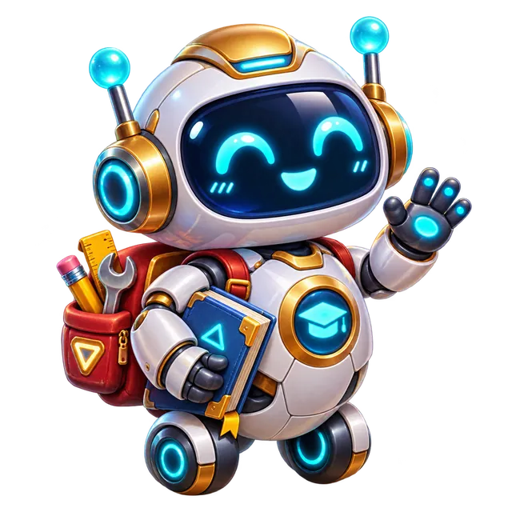
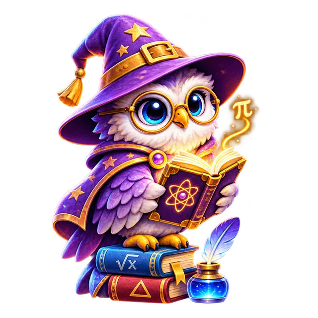
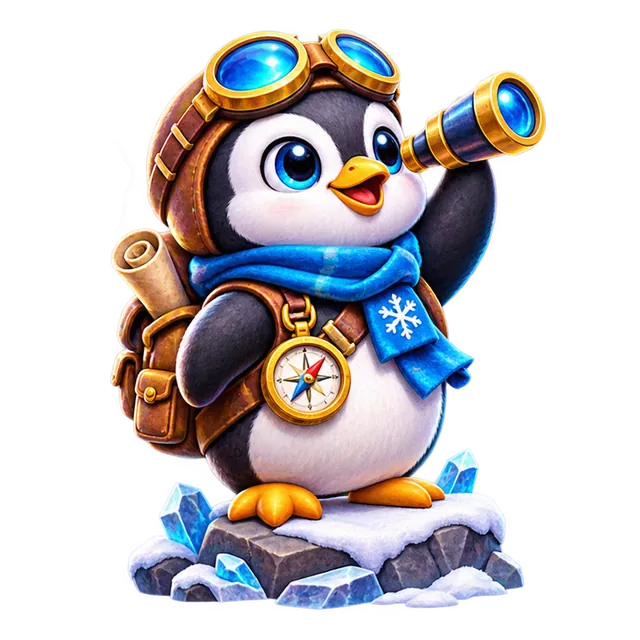

# МатКвест · UX-104 — три премиальных питомца, первая партия — художественная приёмка

**Дата:** 8 ноября 2026 · **статус:** 3 готовых оригинальных **кандидата**, интеграция в приложение ещё **НЕ выполнена**.

**Источник истины:** `ux-final/ux00-inventory-20261108` · **PWA staging v102**, **production main v81**.

## Три подлинных WebP-файла для просмотра

| Мини-бот | Сова | Пингвин |
|:---:|:---:|:---:|
|  |  |  |
| `pet_bot` · 240 монет · необычный · уровень 3 | `pet_owl` · 270 монет · необычный · уровень 4 | `pet_penguin` · 300 монет · редкий · уровень 5 |

Все три — действительно самостоятельные герои; не повторяют исходники аватаров. Каждое изображение — **WebP RGBA 640×640 с настоящей прозрачностью**, а не JPG с нарисованной «шахматкой».

- **Мини-бот:** бело-золотой робот с объёмным светящимся экраном-лицом, книжкой, маленькими колёсами и рюкзачком инструментов, отдельно создан в прозрачном PNG и сжат без потери прозрачности.
- **Сова:** детализированная фиолетово-бежевая сова-маговед с круглой оправой, чародейской шляпой и математической книгой. 
- **Пингвин:** искатель с оптическими очками, телескопом, синим шарфом и компасом; ледяная опора — элемент оригинальной иллюстрации.
- Для Совы и Пингвина был получен **оригинальный рисунок из двух самостоятельных персонажей на одном прозрачном холсте (не скриншот дашборда)**. Изображения аккуратно отделены по полностью прозрачному промежутку, с учётом криволинейной границы, без обрезанных крыльев, книг, лап и телескопа. Оба экземпляра индивидуально проверены на полном размере.

| Исходник | Размер | SHA-256 |
|---|---:|---|
| `assets/candidates/pets/pet_bot.webp` | 78 310 B | `f352dd29dbbcea07e15d5a8b69ae03e7f4286a977c490e2672badbc625efc113` |
| `assets/candidates/pets/pet_owl.webp` | 97 496 B | `4bfaaa6e118047f59081c679bf7161217f8ddb8f0e9d2996468ae5aa84e6ad1d` |
| `assets/candidates/pets/pet_penguin.webp` | 91 090 B | `96c726213840a2b03db6f3f000b80d236f3a09e7fc16c16ba313f7d236127ec2` |

## Техническая проверка — пройдена

**[UX104 Gate #42521576517 — SUCCESS](https://github.com/jokino9212/matkvest/actions/runs/42521576517)** (read-only, не меняет PWA).

- **Проверка подлинного формата:** каждый файл RIFF/WEBP, 640×640, три **разных SHA-256**. Хеши не совпадают с утверждёнными `pet_phoenix.webp`, `pet_orb.webp`, `pet_ghost.webp`.
- **На 48/128/384 px:** альфа во всех четырёх углах = 0; заполнение кадра ≈42–52%, полезный горизонтальный габарит 65–83%, высота 91–96%; нет огромной случайной прозрачной зоны, нет закрашенных фонов.
- **320/390/768/1280 px:** 3/3 изображения отобразились в реальном магазине при **61.19×61.19px**, `object-fit:contain`; все три полноэкранных viewer с Esc/крестиком и без обрезания, коллекция содержит 3/3, рейтинг сохраняет equipped `pet_bot`; нет JS errors или горизонтального overflow.
- **Иммутабельность каталога:** базовый `SHOP_CATALOG` сохраняет 21 запись питомцев (20 реальных + `pet_none`), 55 аватаров, 50 значков, 40 стикеров. В тестах `icon` заменялся только **в памяти временной браузерной страницы**, а не в `index.html`.
- **Не допущена ложная публикация:** исходные файлы находятся **только** в `assets/candidates/pets/`; `sw.js` staging v102 не включает их, `index.html` не ссылается на них.

**Артефакт браузерных тестов:** [`ux104-three-premium-candidate-visual-review`](https://github.com/jokino9212/matkvest/actions/runs/42521576517/artifacts/13633592138). Включает `all_three_48_128_384_light_dark.png`, `zoom_pet_bot_320.png`, `zoom_pet_owl_320.png`, `zoom_pet_penguin_320.png`, 390px-скриншоты и `qa.json`. Реальные изображения открыты и осмотрены после теста: рисунки читаются, объекты не обрезаны; миниатюры Совы и Пингвина более вытянутые, чем Мини-бот (высокие силуэты), но не ошибочный CSS zoom.

**Ранее** две альтернативные Gamma JPG генерации Mini-бота и Совы были отклонены: плоская графика с поддельной шахматной прозрачностью. Нельзя подменять ими эти файлы.

## Следующая операция

Статус `art_acceptance.status=pending_visual_review` в `audits/ux104_batch1_manifest.json` намеренно **сохранён**. Чтобы интегрировать впервые **ст staging v103**, требуется художественное одобрение конкретных трёх файлов: затем скопировать **точно принятые байты** из `assets/candidates/pets` в `assets/source/pets`, записать три SHA-256 и `status=approved` в manifest, запустить полный `.github/workflows/ux104-pet-batch1-v103.yml` (профили/PWA/офлайн/экономика/35+ регрессий) и только после полного Gate обновить **staging**. `main` никогда не трогать без отдельного выпуска.

**Следующая художественная партия UX-104:** `pet_dino`, `pet_cat`, `pet_dragon` (ещё 3 из 7 дубликатов); после них `pet_fox`, `pet_turtle`, `pet_tiger`, `pet_astronaut`. Суммарное число **20 реальных питомцев**, цель **≥30** относится к UX-105 и ещё не достигнута.
