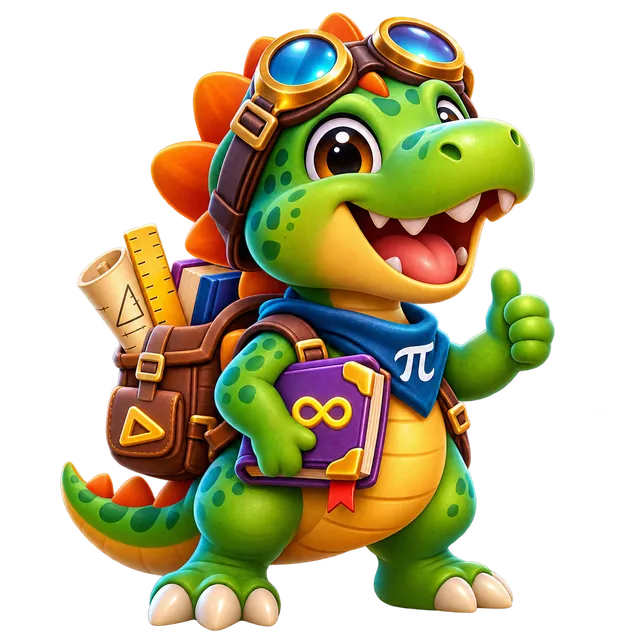
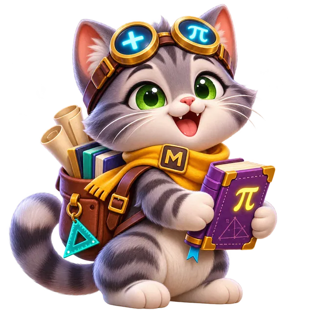
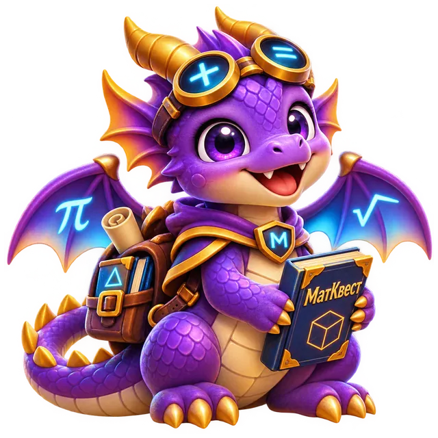

# МатКвест · UX-104 — вторая партия премиальных питомцев (3 кандидата)

**Контрольная дата:** 9 ноября 2026 · **ветка:** `ux-final/ux00-inventory-20261108`.

**Статус:** изготовлены и загружены в GitHub три оригинальных качественных рисунка, **только художественные кандидаты**. Никаких изменений настоящего магазина, коллекции, аватаров, PWA или production. **Staging v102, production v81.**

## Настоящие изображения, непосредственно из GitHub

| Динозавр | Кот | Дракончик |
|:---:|:---:|:---:|
|  |  |  |
| `pet_dino` · **360** монет · rare · ур. 6 | `pet_cat` · **390** монет · rare · ур. 7 | `pet_dragon` · **500** монет · epic · ур. 9 |

Каждый исходник — отдельный WebP RGBA **640×640**, не обрезок интерфейса, не замена аватара и не упрощённая векторная имитация. Отличаются силуэтом, мордочкой и характерными деталями; рисовались специально как персонажи математической игры. Углы прозрачны, на заднем плане нет непрозрачной плитки.

| Исходник | Вес | SHA-256 |
|---|---:|---|
| `assets/candidates/pets/pet_dino.webp` | 72 176 байт | `63bb54a3516474bb25507a15dff64065a0281f9bb3ae68da079fdb0ccb2cc52c` |
| `assets/candidates/pets/pet_cat.webp` | 93 108 байт | `9832ef0f4c62ed5cbd9d16a7d54cfb8bf93fada48c124ce369d2340ff3b3b9ad` |
| `assets/candidates/pets/pet_dragon.webp` | 111 358 байт | `86e0af857742de85ab2b3c51674af9aa93387267aa453a300274d28d50bdd15f` |

**GitHub хранит побайтно оригинальные WebP:** вычисленные вручную git-blob SHA-1 полностью совпали с тремя фактическими новыми blob GitHub в commit `965a5a995c532d3bd8c060dcdac3cb0461285f68`.

## Полный браузерный Gate

**[GitHub Actions UX-104 batch 2 #42527993662](https://github.com/jokino9212/matkvest/actions/runs/42527993662) — SUCCESS.**

- Реальные WebP корректно декодируются `640×640`, точные SHA-256 совпадают. Три рисунка отличны друг от друга и от шести уже существующих премиальных WebP (трёх активных v102 и трёх кандидатов первой партии).
- Alpha QA на **48, 128 и 384 px**: все 4 угла у каждого питомца строго прозрачные; контентное покрытие порядка **50–62%**, реальная высота почти весь доступный холст. Отсутствует типичная «лужа» и слишком маленький рисунок.
- Браузерный Gate на **320/390/768/1280 px**: настоящая картинка в карточке магазина **61,19×61,19 CSS px**, не растягивается и не обрезается; проверена коллекция, рейтинг и полноэкранный viewer (закрытие через Esc). Нет JS ошибок или горизонтального переполнения.
- Тест на живом временном `SHOP_CATALOG` не изменяет реальные ID/имена/цены/уровни/редкости, 21 запись питомца (=20 настоящих + `pet_none`), 55 аватаров, 50 значков и 40 стикеров. Исходные аватары `av_dino`, `av_cat` и `av_dragon` не изменены.
- Приложение `index.html` / `sw.js` **не ссылается на художественных кандидатов**, их нет в cache, stage остаётся v102. Проверка явно запрещает непреднамеренное подключение не одобренных рисунков.

Скриншоты реальных окон в артефакте [`ux104-batch2-premium-3-pet-visual-review`](https://github.com/jokino9212/matkvest/actions/runs/42527993662/artifacts/13635952250), включая `zoom_pet_dino_320.png`, `zoom_pet_cat_320.png`, `zoom_pet_dragon_320.png`, галерею в 48/128/384 px и `shop_last_320.png`. Эти снимки непосредственно просмотрены в текущем сеансе: фигуры персонажей полностью видны, крестик закрытия доступен, фон fullscreen корректен.

## Итоги и следующий шаг

- Художественная партия 1: **3/3 готовых кандидата** — Мини-бот, Сова, Пингвин; [отчёт](UX104_BATCH1_PREMIUM_CANDIDATES.md).
- Художественная партия 2: **3/3 готовых кандидата** — Динозавр, Кот, Дракончик (эта проверка).
- Совокупно **6 из 10 повторяющихся питомцев имеют новые отдельные кандидаты**; **ни один пока не заменён в staging** без художественной приёмки. Счётчик питомцев всё ещё **20/30**, а не 26/30: мы меняем изображения, а не добавляем новые IDs.
- Следующие четыре существующих ID для самостоятельного рисунка: `pet_fox` (260, uncommon, L3), `pet_turtle` (280, uncommon, L4), `pet_tiger` (340, rare, L6), `pet_astronaut` (450, epic, L8). Затем UX-105 — +10 новых ID до 30.
- Для публикации партии требуется отдельно оценить **настоящие** изображения (не иллюстративные дашборды), выставить art-approval и sha-подписи, после чего выполнить полный `v81→v103` / subsequent PWA Gate. **Никакой автодеплой в main** без физического Android и релизной приёмки.
